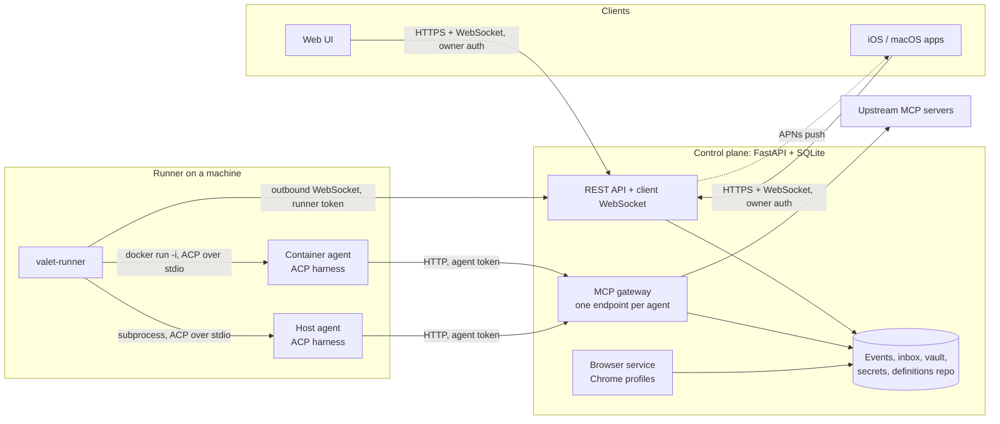

# Valet

A control plane for always-on AI agents: run [ACP](https://agentclientprotocol.com) harnesses (Claude Code,
[DeepSeek Harness](https://github.com/deepseek-ai/deepseek-harness)) in containers or on your own machines, and use
them from a web UI or iOS and macOS apps.

<!-- Screenshot: add one at docs/images/screenshot.png and uncomment.

-->

## What it is

Coding agents such as Claude Code are built for one terminal. Valet turns them into long-lived services you can
reach from a phone. You define an agent in a form (who it is, which harness and model, what computer it gets, how
much it may do without asking), and Valet starts it, keeps its conversations, and puts every permission request in
an inbox you can answer from the web UI, the apps, or a push notification.

Valet owns the boundary around the agent, not the harness's own permission system. It decides where the agent runs
(a container, or the runner's machine), what the container can reach on the network, which tools it gets (all
through one MCP gateway that Valet controls), which secrets it sees, and what it is told. Because it talks to
harnesses over ACP, an agent's definition is not tied to one of them.

## Features

- **Harnesses over ACP.** Claude Code and DeepSeek Harness have adapters today (`valet/runner/harness/`). Conversations
  are stored in a harness-neutral event format.
- **Where agents run.** A private Docker container per agent (its home and `/work` persist between restarts), no
  computer at all (tools only), or a plain process on the runner's machine.
- **Four permission levels** per agent: locked, ask, trusted, unrestricted. Approvals arrive in an inbox.
- **MCP gateway.** An agent's external tools come only through Valet's gateway, which runs allow, ask or block rules
  per tool. Credentials for upstream servers stay in the control plane.
- **Secrets and a login vault**, encrypted at rest and injected into an agent as environment variables, by name.
- **Browser.** Agents can drive a real Chrome profile with per-site rules, a vault for logins, and a live view you
  can take over.
- **Always-on.** Schedules, webhooks and wake-ups start an agent's turns without you.
- **Memory, shared space, skills.** Per-agent memory and a shared folder, and skills the agent loads on demand.
- **Clients.** A phone-first web UI (plain HTML/JS, no build step) and SwiftUI apps with push notifications, Face ID,
  a terminal and a file browser for the agent's computer.
- **Definitions are files in git.** Every settings change is a commit you can diff or restore.

## Requirements

- Python 3.13 and [uv](https://docs.astral.sh/uv/)
- git
- Docker, for `container` agents and for running the control plane in a container
- A harness credential on the runner: a Claude subscription token (`claude setup-token`) or `ANTHROPIC_API_KEY`
  for Claude agents, `DEEPSEEK_API_KEY` for DeepSeek Harness agents
- For the native apps: Xcode 26 and [XcodeGen](https://github.com/yonaskolb/XcodeGen), and an Apple developer account
  to run on a device or to get push

## Quickstart

State lives in `./data` unless `VALET_DATA` says otherwise (it is git-ignored).

```sh
uv sync

# 1. The image container agents run in (Node, Claude Code and its ACP adapter, DeepSeek Harness)
docker build -t valet/agent-base docker/agent-base

# 2. The control plane: set the owner password, register a runner (prints a vrun_... token once), serve
uv run valet-control set-password
uv run valet-control add-runner mac
uv run valet-control serve                    # http://127.0.0.1:8780

# 3. A runner, in another terminal (it dials out to the control plane)
export VALET_RUNNER_TOKEN=vrun_...
export CLAUDE_CODE_OAUTH_TOKEN=...            # from `claude setup-token`
export DEEPSEEK_API_KEY=...                   # only if you use DeepSeek Harness
uv run valet-runner
```

Open http://127.0.0.1:8780, sign in, create an agent and start it.

To run the control plane in Docker instead, see `docker/compose.yml` and "Deploying with Docker" in
[docs/GUIDE.md](docs/GUIDE.md#deploying-with-docker). The runner then runs on the host, as a systemd service
(`docker/valet-runner.service`) or by hand, so that `host` agents and the host's Docker are available to it.

## Configuring a harness

An agent's harness is one line of its definition, `agents/<name>/agent.yaml` in the definitions repo (the settings
page writes it for you):

```yaml
name: helper
harness: claude          # claude | deepseek
model: claude-sonnet-5-5 # optional; for deepseek, e.g. deepseek-v4-pro
computer:
  level: container       # container | none | host
permissions: ask         # locked | ask | trusted | unrestricted
```

The harness's credential is not part of the definition. It comes from the runner's environment
(`CLAUDE_CODE_OAUTH_TOKEN` or `ANTHROPIC_API_KEY`, `DEEPSEEK_API_KEY`), and each agent receives only its own
harness's keys. The runner reports which harnesses it has a key for (names only), and the settings page marks the
others "no key". Each harness's command can be replaced with `VALET_HARNESS_CMD_<HARNESS>`, for example to point at
a different ACP binary. How each harness receives the definition (system prompt, model, permissions, MCP gateway,
skills) is tabulated in [docs/GUIDE.md](docs/GUIDE.md#defining-an-agent).

## Configuration

Everything is environment variables. The common ones:

| variable | default | |
|---|---|---|
| `VALET_DATA` | `./data` | database and, by default, the definitions repo |
| `VALET_HOST`, `VALET_PORT` | `127.0.0.1`, `8780` | where the control plane listens |
| `VALET_PUBLIC_URL` | `http://127.0.0.1:8780` | the address browsers use; `https` makes the session cookie `Secure`, and browser requests from other origins are refused |
| `VALET_MASTER_KEY` / `VALET_KEY_FILE` | `$VALET_DATA/master.key` | the key secrets are encrypted with |
| `VALET_GATEWAY_URL` | `$VALET_PUBLIC_URL` | how agents reach the MCP gateway; container agents need an address that is not `127.0.0.1` (on Docker Desktop, `http://host.docker.internal:8780`) |
| `VALET_CONTROL_URL` | `ws://127.0.0.1:8780/ws/runner` | runner: where to dial |
| `VALET_RUNNER_TOKEN` | required | runner: from `valet-control add-runner` |
| `VALET_APNS_KEY_FILE`, `_KEY_ID`, `_TEAM_ID`, `_TOPIC`, `_SANDBOX` | unset | push notifications (below) |

The full table (timeouts, browser, time zone, owner name, runner options) is in
[docs/GUIDE.md](docs/GUIDE.md#configuration). There are no default passwords or tokens: the owner password and
every runner token are created by you with `valet-control`.

## Architecture



- **Control plane** (`valet/control/`): holds all state and policy. It never runs agents.
- **Runner** (`valet/runner/`): runs where the agents should run. It connects outward to the control plane, so it
  needs no inbound port. It starts each agent's harness (in a container or as a host process) and speaks ACP to it
  over stdio. You can run several runners on different machines.
- **Harness adapters** (`valet/runner/harness/`): turn an agent definition into a harness's command, environment
  and config files.
- **Clients** (`valet/control/static/`, `apps/`): the web UI and the native apps use the same REST API and
  WebSocket.

Design notes: [docs/DESIGN.md](docs/DESIGN.md). Wire formats: [docs/API.md](docs/API.md) (clients) and
[docs/PROTOCOL.md](docs/PROTOCOL.md) (control plane to runner).

## Security model

Valet runs software that can execute code and holds credentials, so read this before exposing it. It describes what
the code does; it is not an audit, and the project has not had an independent review.

**Who is trusted.**
- There is one owner, with one password (argon2, set with `valet-control set-password`). The owner can do
  everything: change definitions, read and set secrets, open a terminal in an agent's computer, approve requests.
- Runners are trusted by the control plane once they present their token (`valet-control add-runner`; only its
  sha256 is stored; `revoke-runner` drops a connected runner within 5 seconds). A runner receives each agent's
  secrets at start, and `host` agents run as the runner's user, so run runners only on machines you control.
- Agents are not trusted. Each gets a gateway token for its own endpoint only, and the gateway takes agent tokens,
  never the owner's. An agent's own permission rules and hooks written into Claude's settings files are ignored:
  Valet's managed settings are the only ones in force.
- Stdio MCP servers you register run on the control plane's host, as its user, unsandboxed. Register only servers
  you trust.

**Secrets.** Secrets and vault entries (passwords, TOTP seeds) are stored AES-256-GCM encrypted, bound to their
name, with a key from `VALET_MASTER_KEY` or a `master.key` file (mode 0600, created on first use). Whoever can read
both the database and the key can read the secrets: keep them in separate backups. Values are write-only in the UI
and API (names are listed, values are not). A secret reaches an agent as an environment variable of the same name
in its harness process; it is passed through the docker CLI's environment, so `docker inspect` on the container
shows it. An MCP server credential (`${secret:NAME}`) stays in the control plane and is never given to the agent.
A harness's own API key stays in the runner's environment and goes only to agents of that harness.

**Web UI and app auth.** The session is a signed token valid for 30 days, carried as an httponly,
`SameSite=Strict` cookie (`Secure` when `VALET_PUBLIC_URL` is https) or as a `Bearer` token for API clients, which
is what the apps use (they keep it in the Keychain, behind Face ID or Touch ID if you enable the lock). Browser
requests and sockets whose origin is not `VALET_PUBLIC_URL` are refused. Failed logins are rate limited per client
IP in memory. Every API route except login, logout, `/api/me` and the static UI needs the session. Public webhooks
need their own key (`Bearer vhk_...`) or a GitHub-style HMAC signature.

**Permission approvals.** The permission level (locked, ask, trusted, unrestricted) sets what the harness asks
about. For Claude Code it maps to a permission mode; for DeepSeek Harness, Valet's own approval gate decides, and
if the gate cannot load, the agent fails to start rather than running without approvals. A request that needs you
becomes an inbox item, shown in the session, the web UI and the apps, and pushed as a notification (through APNs
or a webhook you set) with actions to allow or reject, once or always where the harness supports it. Tool calls
through the MCP gateway are decided there instead: allow, ask (an inbox item that waits `VALET_GATEWAY_ASK_TIMEOUT`,
default 600 seconds, then is refused) or block, from per-tool rules, and without a rule it follows the server's own
annotations, so destructive tools ask. A level change applies from the agent's next start to all its sessions.
Browser actions that commit (a purchase, a form submit) ask too, under per-site rules.

**Network exposure.**
- By default the control plane listens on `127.0.0.1` only. Keep it there and put an https reverse proxy or tunnel
  (Cloudflare Tunnel, Tailscale Serve, Caddy, nginx) in front, with `VALET_PUBLIC_URL` set to the exact public
  address. Do not publish port 8780 on a public interface. There is no TLS in Valet itself, and over plain http
  the password and session token travel in the clear.
- Runners connect out to the control plane. A runner on another machine needs only an outbound path to it.
- Agents must reach the gateway. For container agents that means the control plane has to listen on an address the
  Docker bridge reaches (`docker/compose.yml` publishes it on the bridge IP only, not on external interfaces).
- Per-agent Internet policy for container agents: `open`, `gateway` (only the model API and Valet's tools) or
  `allowlist`, enforced by a proxy that decides by hostname. An allowed name that resolves to a private address is
  reachable. These policies were tested on Docker Desktop for macOS only, not yet on Linux. For `host` agents the
  policy does not apply: they reach whatever the runner's user can.
- Shared-folder mounts are passed to Docker as given; nothing restricts which host paths you mount.

**Other limits.** A webhook's content reaches the agent as text in a prompt, and the harness cannot tell it from
instructions, so write the agent's instructions with that in mind. DeepSeek Harness is a developer preview with
no security audit of its own. More in [docs/GUIDE.md](docs/GUIDE.md#not-done-yet).

## The apps

`apps/` has SwiftUI apps for iOS 17+ and macOS 14+ (`apps/ValetKit` is the shared Swift package). On first launch
they ask for your server address and the owner password. Building them takes Xcode 26 and XcodeGen; see
[apps/README.md](apps/README.md).

The Xcode project ships with the author's Apple team ID and bundle ID (`br.com.rrayes.valet`), which will not work
for you. To build under your own account, change `DEVELOPMENT_TEAM`, `bundleIdPrefix` and the three
`PRODUCT_BUNDLE_IDENTIFIER` values in `apps/project.yml`, run `xcodegen`, and set `VALET_APNS_TOPIC` on the control
plane to your bundle ID. Push also needs your own APNs auth key: set `VALET_APNS_KEY_FILE`, `VALET_APNS_KEY_ID` and
`VALET_APNS_TEAM_ID` (`VALET_APNS_SANDBOX=1` for development builds). No key is included; without one, push is off
and the apps still work.

## Development and tests

```sh
uv sync
uv run pytest                                  # offline: loopback only, no Docker, no API key
VALET_TEST_DOCKER=1 uv run pytest -m docker    # builds on the real agent image
VALET_TEST_CHROME=1 uv run pytest -m chrome    # a real headless Chrome
(cd apps/ValetKit && swift test)               # Swift unit tests
```

The offline suite runs the real control plane and runner against `tests/fake_agent.py`, a scripted ACP agent. You
can use it by hand with `VALET_HARNESS_CMD_CLAUDE="$PWD/.venv/bin/python $PWD/tests/fake_agent.py" uv run valet-runner`
and an agent at `computer.level: host`. Test layout and the iOS UI tests are described in
[docs/GUIDE.md](docs/GUIDE.md#tests) and [apps/README.md](apps/README.md).

## Status and limitations

Valet is a personal project in active development, used daily by its author and not yet widely tested by others.
Expect rough edges and breaking changes. Known gaps include: harness keys come only from the runner's environment;
the browser runs on the control plane's host and stops on a restart; the MCP gateway is a first slice; network
policies are untested on Linux; a webhook to a stopped agent is refused, not queued. The list is in
[docs/GUIDE.md](docs/GUIDE.md#not-done-yet).

## Documentation

- [docs/GUIDE.md](docs/GUIDE.md): the user guide (agent settings, permission levels, tools, browser, memory, always-on)
- [docs/DESIGN.md](docs/DESIGN.md): design and architecture
- [docs/API.md](docs/API.md): REST API and client socket
- [docs/PROTOCOL.md](docs/PROTOCOL.md): control plane to runner
- [apps/README.md](apps/README.md): the native apps

## License

[MIT](LICENSE)
